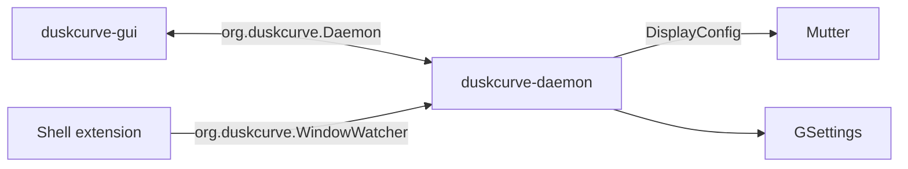

# Duskcurve

Circadian colour temperature for GNOME on Wayland, with an editable day curve, per-display control and window rules.

[](https://github.com/jomino151/duskcurve/actions/workflows/ci.yml)
[](LICENSE)


## Why

Mutter implements neither X11 RANDR gamma nor the wlroots gamma protocol, so redshift and gammastep cannot work on GNOME/Wayland.
Duskcurve sets gamma ramps through `org.gnome.Mutter.DisplayConfig` directly.
Inspired by f.lux.

## Features

- Editable keypoint curve anchored to sunrise, sunset, wake and bedtime.
- Per-display overrides: disable, warm cap, fixed temperature or mired offset.
- App and fullscreen rules, including fullscreen windows on a display you are not using.
- Timed manual overrides for all displays or one.
- Light/dark theme switching that catches up after suspend.
- GTK4/libadwaita GUI.

## Requirements

- Ubuntu 26.04, GNOME 50, Wayland.
- Python 3.12 or newer.
- `python3-gi` and `python3-venv`.
- Optional: `python3-gi-cairo` for the curve editor.

Other GNOME versions run everything except window rules, because the shell extension only loads on GNOME 50.

## Install

```bash
git clone https://github.com/jomino151/duskcurve.git
cd duskcurve
./install.sh
```

The installer creates a venv in `~/.local/share/duskcurve`, links `duskcurve-daemon`, `duskcurve-gui` and `duskcurve-apply` into `~/.local/bin`, installs the shell extension and a systemd user unit, and starts the daemon. Re-run it to upgrade.

| Flag | Effect |
| --- | --- |
| `--dev` | Editable install and a symlinked extension, for working on the code. |
| `--no-start` | Install without enabling or starting the daemon. |

Log out and back in afterwards. On Wayland GNOME Shell cannot restart in place, so the extension and window rules start working only in a new session.

Set your location and wake and bedtime in the GUI or in `~/.config/duskcurve/config.toml`. See [docs/configuration.md](docs/configuration.md) for every key.

## Uninstall

```bash
./uninstall.sh
```

This resets every display to 6500 K, restores Night Light to its pre-install value and removes everything the installer added. If that value was never recorded, it leaves Night Light alone and says so.

| Flag | Effect |
| --- | --- |
| `--purge` | Also delete `~/.config/duskcurve/config.toml`. |

## Architecture

A daemon, a GUI and a GNOME Shell extension talk over the session D-Bus.
The daemon owns the config and sets each display's gamma through Mutter.
The GUI edits the config through the daemon.
The extension reports focused and fullscreen windows, which only code inside GNOME Shell can see on Wayland.
Schedule, colour, rule and theme logic is pure Python and runs in tests without a session; GLib and GTK code sits at the edges.
See [docs/architecture.md](docs/architecture.md).



## Development

```bash
python3 -m venv --system-site-packages .venv && .venv/bin/pip install -e '.[dev]'
.venv/bin/pytest
.venv/bin/ruff check . && .venv/bin/ruff format --check .
.venv/bin/mypy
```

See [CONTRIBUTING.md](CONTRIBUTING.md) and [CHANGELOG.md](CHANGELOG.md).

## Licence and credits

GPL-3.0-or-later; see [LICENSE](LICENSE).

The blackbody colour table in `duskcurve/color/blackbody_table.py` comes from [redshift](https://github.com/jonls/redshift) by Jon Lund Steffensen, also GPL-3.0.
