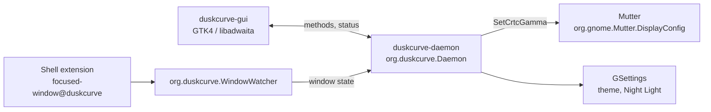

# Architecture

Duskcurve is three processes that talk over the session D-Bus.



| Component | Role |
| --- | --- |
| `duskcurve-daemon` | Owns the config, evaluates the curve every tick and sets each display's gamma ramp. |
| `duskcurve-gui` | Edits the config through the daemon; it never writes the file itself. |
| Shell extension | Reports the focused window and visible fullscreen windows, which a process outside GNOME Shell cannot see on Wayland. |
| `duskcurve-apply` | Sets a fixed temperature once; `./uninstall.sh` uses it to reset displays. |

## Code layout

| Package | Contents | Imports `gi` |
| --- | --- | --- |
| `duskcurve.schedule` | Solar events, keypoint curves, built-in modes | no |
| `duskcurve.color` | Blackbody table, mired maths, gamma ramps, presets | no |
| `duskcurve.theme` | Light/dark policy | no |
| `duskcurve.daemon` | Config, rules, orchestrator, D-Bus service | only `main.py`, `watcher.py` |
| `duskcurve.backend` | Mutter, GSettings and Night Light adapters | the GLib adapters |
| `duskcurve.gui` | GTK views over pure state and editing modules | the widget modules |

The pure modules carry the logic and are tested without a display or session bus.

## Precedence

What a display shows, highest first:

```
paused > display disabled > manual temperature > rule > curve + per-display override
```

The desktop theme follows its own chain: `paused (freeze) > manual theme > theme anchors`. Rules never change the theme.
